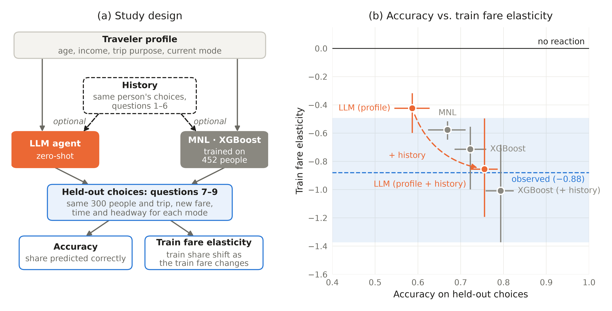

# Behavior prediction of human travelers with ML + LLM

## Summary
Predicting how travelers respond to operational changes, such as a fare increase, is important for mobility service providers.
I tested how well a large language model (LLM) does this, against a discrete choice model and a machine learning model.

I found that **the LLM reaches accuracy comparable to XGBoost (76% vs. 79%) and recovers the observed train fare elasticity (−0.85 vs. −0.88)** when it knows a person's earlier choices.
This suggests LLMs can be useful for behavioral prediction: they bring prior knowledge of how people travel without any training data, and can adapt to an individual from a few past choices.

<p align="center">
  
  <br>
  <sub>All models scored on the same 900 held-out choices. Bars: 95% CI.</sub>
</p>

## Method

The experiment uses three model families in five setups to predict mode choices in the scenario-based Swissmetro survey.
I started with a *multinomial logit model* (MNL), which is interpretable but less predictive.
I then trained *XGBoost* as a machine learning approach, once on the full training sample and once with history
(predicting each person's last 3 choices from their first 6).
Finally, I prompted *a local LLM to role-play each traveler* and read its choice probabilities from the log-probs of the answer letters,
once with the traveler's profile only and once with their 6 earlier choices added.

| | |
|---|---|
| **Dataset** | Swissmetro stated-preference survey: 752 travelers with 9 scenario-based choices (train, Swissmetro, car) |
| **Design** | 300 test travelers: Q1–6 as history, Q7–9 held out; 452 training travelers for MNL and XGBoost |
| **LLM** | Local Qwen via Ollama (Qwen 3.5, 27.3B, Q5_K_M), zero-shot, probabilities from letter log-probs |
| **Measures** | Accuracy, recall, own-fare elasticity of the train and Swissmetro shares |

**Example prompt**
<details>
<summary>click to check example prompt</summary>

```text
[system]
You are role-playing a specific traveler answering a travel survey.
Choose the option this traveler would most likely choose
Reply with a single letter only.

[user] You are a traveler making a trip in Switzerland. About you:
- Age: 40-54
- Sex: female
- Annual household income: 50,000-100,000 CHF
- Trip purpose: commuting
- Luggage: no luggage
- Who pays: you pay yourself
- Holds a GA (Swiss annual rail pass, covers train and Swissmetro fares): no
- You currently make this trip by train.

(history version only)
Earlier in this survey you made these choices:

Past choice 1:
A) Train: travel time 112 min, cost 48 CHF, departs every 120 min
B) Car: travel time 117 min, cost 65 CHF
C) Swissmetro: travel time 63 min, cost 52 CHF, departs every 20 min
You chose: C
... (past choices 2-6)

Now choose for this trip:
A) Train: travel time 103 min, cost 48 CHF, departs every 120 min
B) Car: travel time 72 min, cost 65 CHF
C) Swissmetro: travel time 67 min, cost 58 CHF, departs every 10 min

Which option do you choose? Answer with one letter: A, B, C.
```

</details>

## Results

With a person's earlier choices, the LLM reaches accuracy comparable to XGBoost (76% vs. 79%) and recovers the observed
train fare elasticity (−0.85 vs. −0.88).
Without history, the LLM misjudges price sensitivity in opposite directions.
It under-reacts to the train fare (−0.42 vs. −0.88) and over-reacts to the Swissmetro fare (−0.71 vs. −0.63).
History fixes the train fare but overshoots on Swissmetro (−0.39).
History helps both XGBoost and the LLM, and accuracy hides gaps that recall shows.
MNL's 67% accuracy comes mostly from predicting Swissmetro.
It almost never predicts train, so its recall (0.51) is no better than the LLM without history.

| Model | Training data | Accuracy | Recall | Fare elasticity (train) | Fare elasticity (Swissmetro) |
|---|---|---|---|---|---|
| Observed | — | — | — | −0.88 | −0.63 |
| MNL | 452 people, Q1–9 | 0.67 | 0.51 | −0.58 | −0.46 |
| XGBoost | 452 people, Q1–9 | 0.72 | 0.64 | −0.71 | −0.46 |
| XGBoost (+ history) | Q1–6 → Q7–9 | 0.79 | 0.75 | −1.01 | −0.60 |
| LLM (profile) | none | 0.59 | 0.52 | −0.42 | −0.71 |
| LLM (profile + history) | none | 0.76 | 0.69 | −0.85 | −0.39 |

<sub>Full table can be found
[`results/table.md`](results/table.md).</sub>

## Reproduce

Requires [uv](https://docs.astral.sh/uv/) and a local [Ollama](https://ollama.com) serving the LLM
(macOS: `brew install libomp` for XGBoost).

```bash
uv sync && uv run python -m src.download   # set up venv, fetch Swissmetro
uv run pipeline/run_checks.py              # MNL vs Biogeme, observed elasticity on other samples
uv run pipeline/run_agents.py              # LLM calls
uv run pipeline/run_eval.py                # table, metrics, figure
```
**Outputs and layout**
<details>
<summary>click to check outputs and layout</summary>

| Output (`results/`) | Script |
|---|---|
| `fig_headline.png`, `table.md`, `metrics.csv` (every number with CI) | `pipeline/run_eval.py` |
| `agent_probs.csv` (LLM choice probabilities) | `pipeline/run_agents.py` |

`config.yaml` sets the model, sample size, seed and bootstrap. `src/` holds data, prompts, LLM client,
MNL, XGBoost, the fare elasticity and the figure code.

</details>
